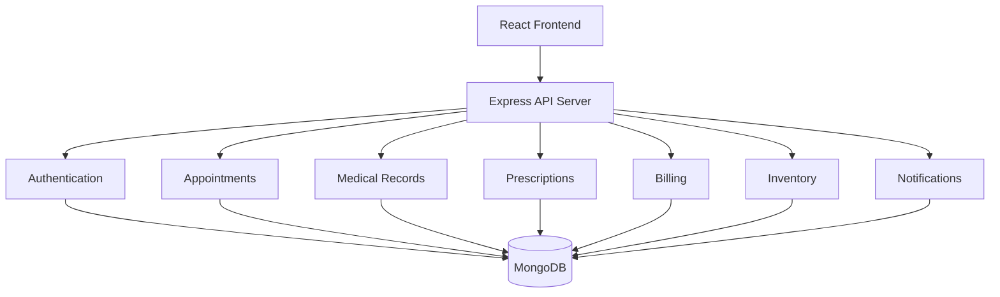
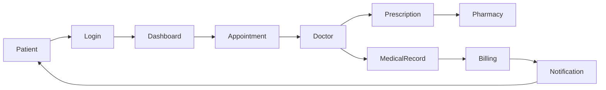
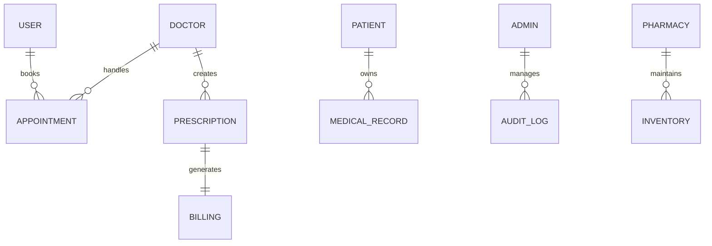

<div align="center">

# 🏥 MediSync

### Enterprise Healthcare Management Platform

*A modern, secure, and scalable healthcare management platform for hospitals and clinics.*

---


<br>

> **Digitizing Healthcare with Secure, Intelligent & Efficient Hospital Workflow Management**

[🚀 Features](#-features) •
[📸 Screenshots](#-screenshots) •
[🏗 Architecture](#-system-architecture) •
[⚙ Installation](#-installation) •
[📚 API](#-api-reference)

</div>

---

# 📖 Overview

MediSync is a full-stack healthcare workflow platform designed to streamline hospital operations through secure digital workflows.

The platform connects **patients, doctors, nurses, pharmacists, receptionists, and administrators** into one centralized system, enabling seamless communication, appointment scheduling, medical record management, billing, prescriptions, inventory tracking, and analytics.

Built with modern web technologies, MediSync emphasizes:

- 🔒 Enterprise-grade security
- ⚡ High performance
- 📈 Scalability
- 🧩 Modular architecture
- 📱 Responsive UI
- ☁ Cloud-ready deployment

Whether used by a small clinic or a large hospital, MediSync provides an efficient digital ecosystem for managing healthcare operations.

---

# ✨ Features

## 👤 Patient Module

- Secure Registration & Login
- Appointment Booking
- Appointment History
- Medical Records
- Prescription History
- Billing Dashboard
- Notifications
- Profile Management

---

## 👨‍⚕️ Doctor Module

- Doctor Dashboard
- Appointment Management
- Patient History
- Digital Prescriptions
- Medical Records
- Diagnosis Notes
- Schedule Management

---

## 👩‍⚕️ Nurse Module

- Patient Triage
- Vital Monitoring
- Medical Observations
- Ward Management
- Assist Doctors

---

## 💊 Pharmacist Module

- Prescription Verification
- Dispense Medicines
- Inventory Management
- Medicine Stock Updates

---

## 🏥 Receptionist Module

- Patient Registration
- Appointment Scheduling
- Queue Management
- Billing Assistance

---

## 👨‍💼 Administrator Module

- User Management
- Staff Management
- Department Management
- Billing Reports
- Analytics Dashboard
- Audit Logs
- Role-Based Access Control
- System Configuration

---

# 🚀 Key Highlights

✅ Role-Based Authentication

✅ JWT Authorization

✅ Secure REST APIs

✅ Real-time Notifications

✅ Appointment Scheduling

✅ Electronic Medical Records

✅ Prescription Management

✅ Billing System

✅ Inventory Management

✅ Audit Logging

✅ Responsive User Interface

✅ Docker Support

---

# 🛠 Technology Stack

| Category | Technologies |
|-----------|--------------|
| Frontend | React, TypeScript, Vite, Tailwind CSS |
| Backend | Node.js, Express.js |
| Database | MongoDB, Mongoose |
| Authentication | JWT, Refresh Tokens |
| Realtime | Socket.IO |
| Security | Helmet, CSRF, HTTP-only Cookies, Rate Limiting |
| DevOps | Docker, Docker Compose, Nginx |
| Version Control | Git, GitHub |

---

# 🏗 System Architecture



---

# 🔄 Application Workflow



---

# 📂 Project Structure

```text
MediSync
│
├── client
│   ├── public
│   ├── src
│   │
│   ├── components
│   ├── pages
│   ├── layouts
│   ├── hooks
│   ├── services
│   ├── utils
│   ├── assets
│   └── App.tsx
│
├── server
│   ├── config
│   ├── controllers
│   ├── middleware
│   ├── models
│   ├── routes
│   ├── services
│   ├── sockets
│   ├── utils
│   └── server.js
│
├── nginx
│
├── docker-compose.yml
│
└── README.md
```


# ⚙ Installation

## Prerequisites

Ensure the following software is installed before running the project.

| Software | Version |
|-----------|----------|
| Node.js | 18+ |
| npm | Latest |
| MongoDB | 7+ |
| Git | Latest |
| Docker *(Optional)* | Latest |

---

## Clone Repository

```bash
git clone https://github.com/yourusername/MediSync.git

cd MediSync
```

---

# 📦 Backend Setup

Navigate to the server directory.

```bash
cd server
```

Install dependencies.

```bash
npm install
```

Create the environment file.

```bash
cp .env.example .env
```

Start the backend server.

```bash
npm run dev
```

Server will run on

```
http://localhost:8080
```

---

# 💻 Frontend Setup

Navigate to client.

```bash
cd client
```

Install dependencies.

```bash
npm install
```

Run development server.

```bash
npm run dev
```

Application runs on

```
http://localhost:5173
```

---

# 🐳 Docker Deployment

Build and start all containers.

```bash
docker compose up --build
```

Run in detached mode.

```bash
docker compose up -d
```

Stop containers.

```bash
docker compose down
```

---

# ⚙ Environment Variables

Create a `.env` file inside the **server** directory.

```env
PORT=8080

MONGO_URI=

JWT_SECRET=

JWT_REFRESH_SECRET=

MASTER_KEY=

ENCRYPTION_SECRET=

COOKIE_SECRET=

CLIENT_URL=http://localhost:5173

NODE_ENV=development
```

---

# 📡 API Reference

## Authentication

| Method | Endpoint | Description |
|---------|----------|-------------|
| POST | `/api/auth/register` | Register user |
| POST | `/api/auth/login` | Login |
| POST | `/api/auth/logout` | Logout |
| GET | `/api/auth/me` | Current user |

---

## Patients

| Method | Endpoint |
|---------|----------|
| GET | `/api/patients` |
| GET | `/api/patients/:id` |
| PUT | `/api/patients/:id` |
| DELETE | `/api/patients/:id` |

---

## Doctors

| Method | Endpoint |
|---------|----------|
| GET | `/api/doctors` |
| GET | `/api/doctors/:id` |
| POST | `/api/doctors` |
| PUT | `/api/doctors/:id` |

---

## Appointments

| Method | Endpoint |
|---------|----------|
| GET | `/api/appointments` |
| POST | `/api/appointments` |
| PUT | `/api/appointments/:id` |
| DELETE | `/api/appointments/:id` |

---

## Medical Records

| Method | Endpoint |
|---------|----------|
| GET | `/api/medical-records` |
| POST | `/api/medical-records` |
| PUT | `/api/medical-records/:id` |

---

## Billing

| Method | Endpoint |
|---------|----------|
| GET | `/api/billing` |
| POST | `/api/billing` |
| PUT | `/api/billing/:id` |

---

## Notifications

| Method | Endpoint |
|---------|----------|
| GET | `/api/notifications` |
| PUT | `/api/notifications/read` |

---

# 🔒 Security Features

MediSync follows industry-standard security practices.

## Authentication

- JWT Access Tokens
- Refresh Tokens
- Secure Session Management
- HTTP-only Cookies

---

## Authorization

- Role-Based Access Control (RBAC)
- Protected Routes
- Permission Validation

---

## API Security

- Helmet Security Headers
- CORS Protection
- Rate Limiting
- Request Validation
- Input Sanitization

---

## Password Security

- bcrypt Password Hashing
- Salted Passwords
- Secure Storage

---

## Monitoring

- Audit Logs
- Request Logging
- Error Logging
- Activity Tracking

---

# 🗄 Database Design



---

# 🧪 Testing

Run backend tests.

```bash
cd server

npm test
```

Build frontend.

```bash
cd client

npm run build
```

Lint frontend.

```bash
npm run lint
```

---

# 📊 Performance

✔ Modular MVC Architecture

✔ Optimized MongoDB Queries

✔ RESTful API Design

✔ Lazy Loaded React Components

✔ Secure Authentication

✔ Responsive UI

✔ Dockerized Deployment

✔ Real-time Notifications

✔ Horizontal Scaling Ready

---

# 📌 Project Status

| Module | Status |
|----------|---------|
| Authentication | ✅ |
| Appointment System | ✅ |
| Medical Records | ✅ |
| Prescriptions | ✅ |
| Billing | ✅ |
| Inventory | ✅ |
| Notifications | ✅ |
| Admin Dashboard | ✅ |
| Docker Support | ✅ |
| Documentation | ✅ |

---
